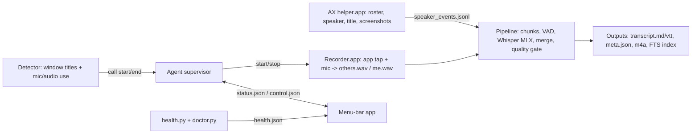

# Architecture

Two halves: a Python agent (`dop_call_recorder`, CLI `dop-recorder`) and ONE small Swift app `DOPCallRecorder.app` (`app/`, built with swiftc, ad-hoc signed, bundle id `com.devopspass.call-recorder`). The executable has three modes chosen by the first argument: recorder commands (`start`, `stop`, `list-apps`, `check-permissions`, `request-mic`, `probe-tap`), Accessibility commands (`check`, `request`, `dump`, `snapshot`, `poll`, `shot`), default = menu-bar app. Python launches it with `open -n -a <app> --args <cmd>` so macOS attributes permissions to the bundle.

## Components
| Component | Where | Role |
|---|---|---|
| CLI | `cli.py` | setup, start, stop, run, status, pause, search, reprocess, doctor, permissions, uninstall |
| Paths | `paths.py` | single source for install prefix, state/log/apps/LaunchAgents dirs; `DOP_STATE_DIR` isolates everything |
| Detector | `detector.py` | combines window title regex + audio signals per watched app, with start/end hysteresis |
| Agent | `agent.py`, `agentstate.py`, `guards.py` | supervises pipeline: pause/resume, notifications, disk guard, retention, caffeinate, status heartbeat |
| Recorder | `app/Sources/recorder.swift`, `recorder_bridge.py`, shim `app/bin/recorder` | per-app audio tap + mic -> two WAVs |
| Pipeline | `pipeline.py`, `windows.py`, `transcribe.py`, `vad_onnx.py`, `quality.py`, `merge.py`, `langid.py`, `outputs.py` | state machine, chunking, VAD, Whisper (MLX), dedupe/merge, markdown/VTT/meta |
| Speaker names | `app/Sources/ax.swift`, `axparse.py`, `axpoll.py`, `ringdetect.py`, `speakerclass.py` | names/title via Accessibility |
| Search | `search.py`, `reprocess.py` | SQLite FTS5 index, re-run old calls |
| Health | `doctor.py`, `health.py` | checks with `fix:` hints, written to `health.json` |
| Menu bar | `app/Sources/menubar.swift` | status icon, pause, permissions submenu |
| Service | `service.py`, `data/*.plist.template` | renders LaunchAgents under `~/Library/LaunchAgents` |

## State files (`~/Library/Application Support/dop-call-recorder/`)
| File | Writer -> reader | Content |
|---|---|---|
| `status.json` | agent -> CLI status, menu bar | state, progress, ETA, queue, disk |
| `control.json` | CLI/menu bar -> agent | pause/resume requests |
| `health.json` | `permissions --write` -> menu bar | permission/health rows |
| `sessions/<id>/session.json` | pipeline | per-call state: idle > recording > finalizing > queued > transcribing > done / failed |
| `ax_self.json` | AX poller | cached own display name |

## Speaker detection chain
Others' lines get a name from the first source that has evidence: **AX** (Accessibility active speaker / single remote participant) > **learned class** (`speakerclass.py`, from earlier calls) > **ring** (screenshot of the speaking ring via the AX helper) > **unmuted** roster state > fallback `Others`. Me = own display name (AX or `[ax] my_name`).

## Permissions model
TCC is per bundle id; the single app holds Microphone, System Audio, Accessibility, Screen Recording (screenshots) and Notifications. Ad-hoc signing means the identity is the code hash: every rebuild or `brew upgrade` resets the grants (one app = one set of prompts, not three). Pre-merge installs (three apps) are removed by `dop-recorder setup`; their old permission entries can be deleted in System Settings.

See `INTERNALS.md` for per-milestone detail and benchmarks.
